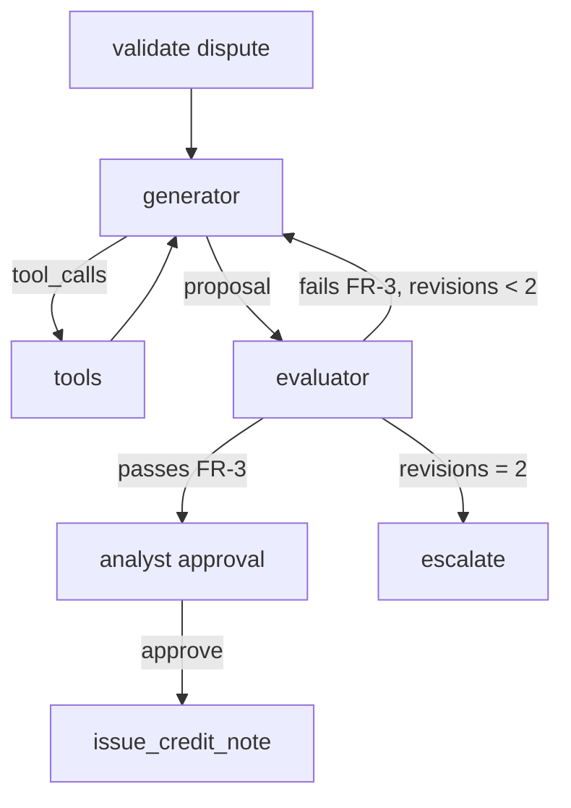

<!-- fictional fixture: design doc of an invented agent already in production; names, numbers and owners are made up for tests -->
# Agent Design — Invoice dispute agent — v1.4 — in production since 2026-04-14 (fictional)

**Decision:** Generator + evaluator because v1.0 (single agent) released credit-note proposals that failed finance rubric FR-3 in 7 of 200 sampled runs (Q3 = no, Q4 = adversarial_review) and FR-3 is objective (Q5 = yes).

## Change log
| Version | Date | Change |
|---|---|---|
| v1.0 | 2026-04-14 | Single agent, 3 read tools + issue_credit_note behind HITL |
| v1.4 | 2026-08-30 | Evaluator node added against FR-3 (max 2 revisions) before the HITL checkpoint |

## 1. Job and success metric
| Item | Value |
|---|---|
| Job to be done | Propose a resolution for an inbound invoice dispute; a finance analyst approves any credit note |
| Success metric (baseline → target) | proposals accepted without edit: 61% → 80% (fictional baseline from v1.0 traces) |
| Users / callers | Accounts-receivable analysts (fictional Northwind finance team) |
| Volume (runs/day) | 140 (fictional) |
| Latency SLO / cost envelope per run | p95 45 s / $0.09 (fictional) |

## 2. Pattern decision
| Option | Meets criteria? | Reason |
|---|---|---|
| Workflow | no | dispute paths depend on contract terms and payment history |
| Single agent | no | v1.0 failed FR-3 in 7 of 200 sampled runs |
| Generator + evaluator | yes | FR-3 is objective; one evaluator pass costs less than a wrong credit note |

## 3. State schema
| Field | Type | Owner node | Reducer | Reset rule |
|---|---|---|---|---|
| dispute | object | entry | replace | per run |
| proposal | object | generator | replace | per revision |
| verdict | object | evaluator | replace | per revision |
| revisions | integer | evaluator | add | per run |

## 4. Graph

| Node | Responsibility | Model/tool | Timeout | Retry |
|---|---|---|---|---|
| generator | draft the resolution and credit-note amount | primary model | 20 s | 1 |
| evaluator | score the proposal against FR-3 | evaluator model | 10 s | 0 |

## 5. Tool contracts
| Tool | Side-effect class | Idempotent | Scopes | Timeout | Error codes |
|---|---|---|---|---|---|
| lookup_invoice | read | yes | invoices:read | 5000 ms | NOT_FOUND, TIMEOUT |
| issue_credit_note | irreversible | yes (prepare token) | credits:write | 8000 ms | INVALID_ARGUMENT, CONFLICT |

Contracts: `tools/invoice-dispute-agent.json` (schema: `assets/tool-contract.schema.json`).

## 6. HITL checkpoints
| Checkpoint | Trigger | Human sees | Decisions | Expiry / default |
|---|---|---|---|---|
| Before issue_credit_note commit | side_effect = irreversible | proposal, FR-3 verdict, cited clause | Approve / Edit / Reject | 48h; default do nothing, notify |

## 7. Failure modes
| Failure | Detection | Mitigation | Owner |
|---|---|---|---|
| Evaluator and generator agree on a wrong amount | weekly sample of 30 approved notes | rubric review; analyst approval stays mandatory | Finance AI lead (fictional) |
| Prompt injection in customer email | injection corpus in evals | email body delimited; no write tool before HITL | Security (fictional) |

## 8. Budgets
| Budget | Value |
|---|---|
| Max steps | 12 |
| Max tokens / cost per run | 40k / $0.09 |
| Max wall-clock | 60 s |
| Fan-out cap | n/a |

## 9. Observability and evaluation
- Trace fields: trace_id, thread_id, tenant_id, node, revision, model, prompt_version, tokens, cost, latency, tool_name, fr3_verdict
- Golden set location and gate threshold: see `llm-eval-harness`
- Production sampling rate for review: 5% of approved credit notes

## 10. Security and data
| Concern | Control |
|---|---|
| AuthZ | in code and tool server; tenant from auth context |
| Untrusted content | delimited, labeled; no privileged tools in the same phase |
| PII | customer contact data masked in traces |
| Retention of checkpoints | 90 days |

## 11. Open questions
| # | Question | Owner | Date |
|---|---|---|---|
| 1 | Raise the evaluator revision cap from 2 to 3? | Finance AI lead (fictional) | 2026-11-15 |
