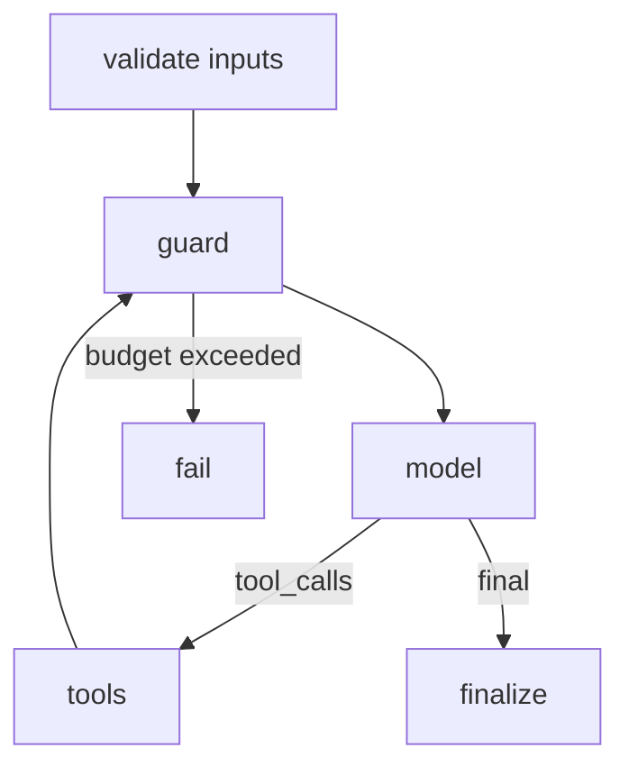

# Agent Design — Ticket triage agent — v0.1 — 2026-10-01

**Decision:** Single agent because triage paths cannot be enumerated for every input (Q1 = no) and the model must pick search vs lookup from ticket content (Q2 = yes); 4 tools fit one context (Q3 = yes).

## 1. Job and success metric
| Item | Value |
|---|---|
| Job to be done | Triage inbound support tickets and propose status/assignee; a human approves writes |
| Success metric (baseline → target) | [TO BE BASELINED — owner: ___] |
| Users / callers | Support leads (fictional Northwind support desk) |
| Volume (runs/day) | |
| Latency SLO / cost envelope per run | |

## 2. Pattern decision
| Option | Meets criteria? | Reason |
|---|---|---|
| Workflow | no | paths vary by product line and attachments |
| Single agent | yes | 4 tools, ~6k tokens of prompt + tools |
| Multi-agent (supervisor) | no | no distinct expertise or data scopes (Q4 = none) |

## 3. State schema
| Field | Type | Owner node | Reducer | Reset rule |
|---|---|---|---|---|

## 4. Graph

| Node | Responsibility | Model/tool | Timeout | Retry |
|---|---|---|---|---|

## 5. Tool contracts
| Tool | Side-effect class | Idempotent | Scopes | Timeout | Error codes |
|---|---|---|---|---|---|
Contracts: `tools/Ticket triage agent.json` (schema: `assets/tool-contract.schema.json`).

## 6. HITL checkpoints
| Checkpoint | Trigger | Human sees | Decisions | Expiry / default |
|---|---|---|---|---|
| Before update_ticket commit | side_effect = irreversible | diff of status/assignee, rationale | Approve / Edit / Reject | 24h; default do nothing, notify |

## 7. Failure modes
| Failure | Detection | Mitigation | Owner |
|---|---|---|---|
| Loop on stuck tool | step count > cap | terminal give-up state + HITL | Platform Lead |
| Prompt injection in ticket body | injection corpus in evals | untrusted content delimited; no write tools in read phase | Security |

## 8. Budgets
| Budget | Value |
|---|---|
| Max steps | |
| Max tokens / cost per run | |
| Max wall-clock | |
| Fan-out cap | |

## 9. Observability and evaluation
- Trace fields: trace_id, thread_id, tenant_id, node, step_count, model, prompt_version, tokens, cost, latency, tool_name, status
- Golden set location and gate threshold: see `llm-eval-harness`
- Production sampling rate for review: 

## 10. Security and data
| Concern | Control |
|---|---|
| AuthZ | in code and tool server; tenant from auth context |
| Untrusted content | delimited, labeled; no privileged tools in the same phase |
| PII | |
| Retention of checkpoints | |

## 11. Open questions
| # | Question | Owner | Date |
|---|---|---|---|
