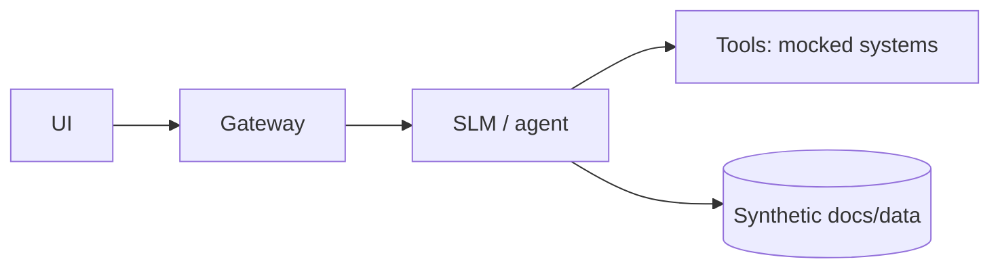

# Demo Spec — <demo name> — v0.1 — <date>

**Decision the demo makes easier:** <one line>

## 1. Audience and persona
| Item | Value |
|---|---|
| Audience | |
| On-screen persona and goal | |
| Vertical / domain | |
| Slot and delivery | <5/10/20 min; live/recorded/self-serve> |

## 2. Before / after
| Today | With the system |
|---|---|
| <steps, minutes — illustrative> | <steps, minutes — illustrative> |

## 3. Happy path
| Step | User input | System action | Visible output | Planted record id |
|---|---|---|---|---|
| 1 | | | | |
| 2 | | | | |
| 3 | | | | |

Wow moments: (1) <> (2) <>

## 4. Handled failure
| Input | Expected behavior | Why it builds trust |
|---|---|---|

## 5. Scope boundary
| Shown and real | Mocked | Roadmap (say so) |
|---|---|---|

## 6. Architecture glance

Data boundary: <where data stays>

## 7. Synthetic data plan
| Entity | Volume | Planted cases | Generator |
|---|---|---|---|

One field table per entity (parsed by `scripts/gen_synthetic.py`; types: id, name, email, date, int, float, enum, bool, text, ref — never ssn / credit_card / phone):

### <entity>
| Field | Type | Example | Constraints |
|---|---|---|---|
| <entity>_id | id | C00001 | prefix=C; width=5 |

## 8. UI stub
| Screen | Inputs | Outputs | States (loading/empty/error) | Mocked vs live |
|---|---|---|---|---|

## 9. Talk track
| Beat | Time | Line | Click |
|---|---|---|---|

## 10. Readiness checklist
- [ ] Cold start < <n> s
- [ ] Scripted inputs produce expected outputs (run 3×)
- [ ] Reset script works
- [ ] Offline cached outputs available
- [ ] "Sample data" footer visible

## 11. Open items
| Item | Owner | Date |
|---|---|---|
