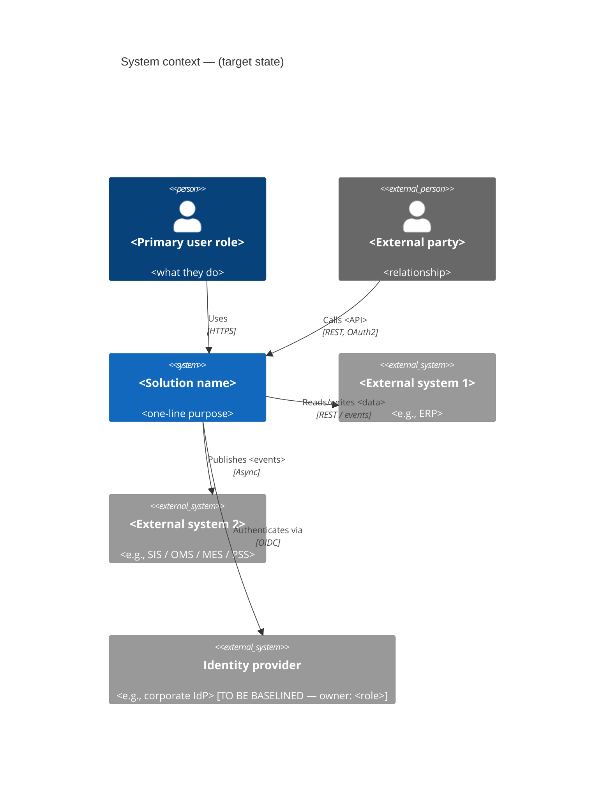
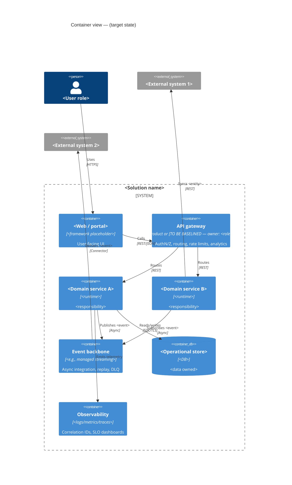
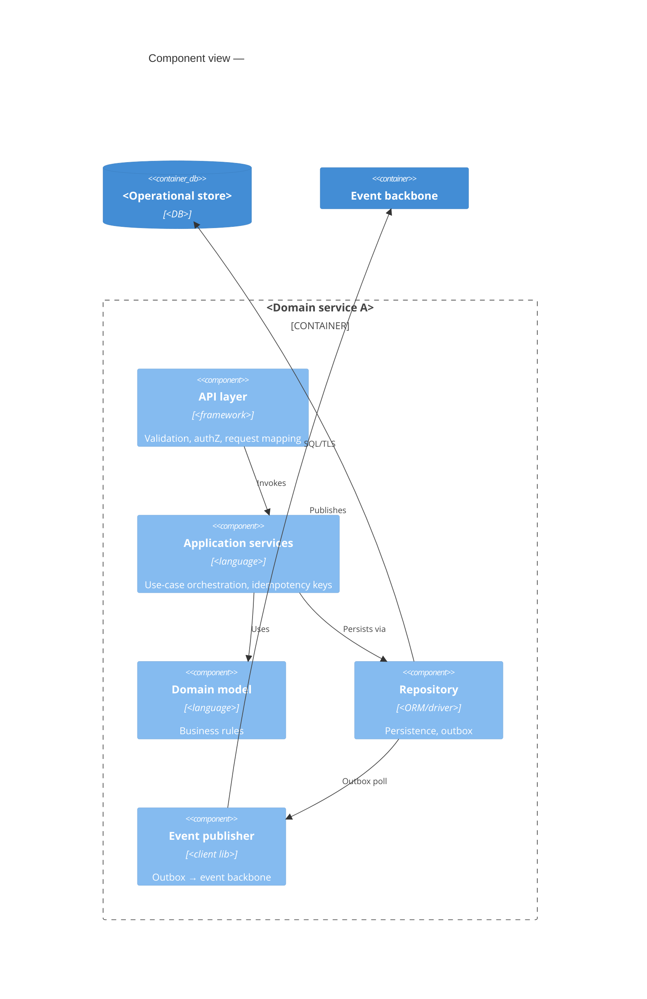
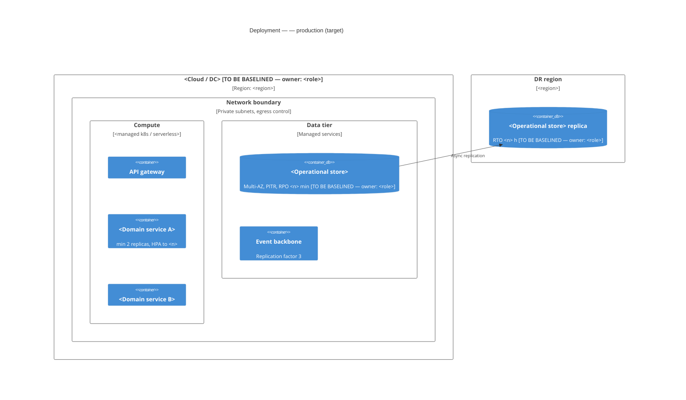
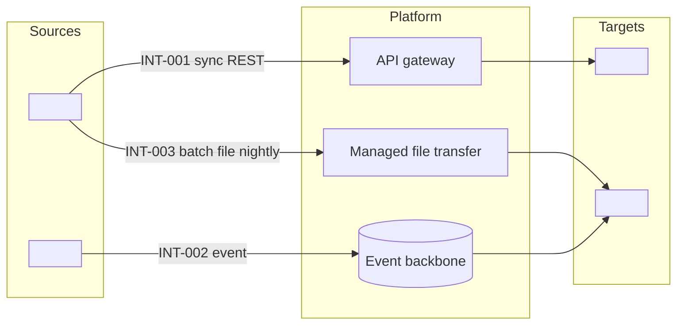
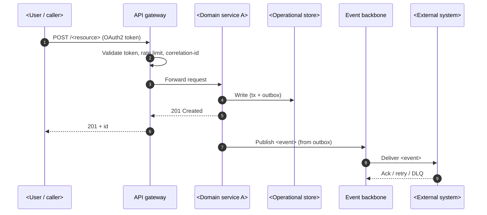
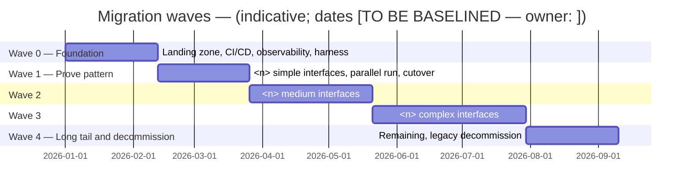

# Mermaid C4 Templates

Replace placeholders. Keep names identical to those used in the document text and integration map. Each diagram gets a caption line beneath it: `*Figure n — <what it shows>; as of <date>; sources: <…>*`.

## C1 — System context

## C2 — Container

## C3 — Component (critical container only)

## Deployment

## Integration flow (optional, for the integration map)

## Critical flow (sequence)

## Migration wave timeline

