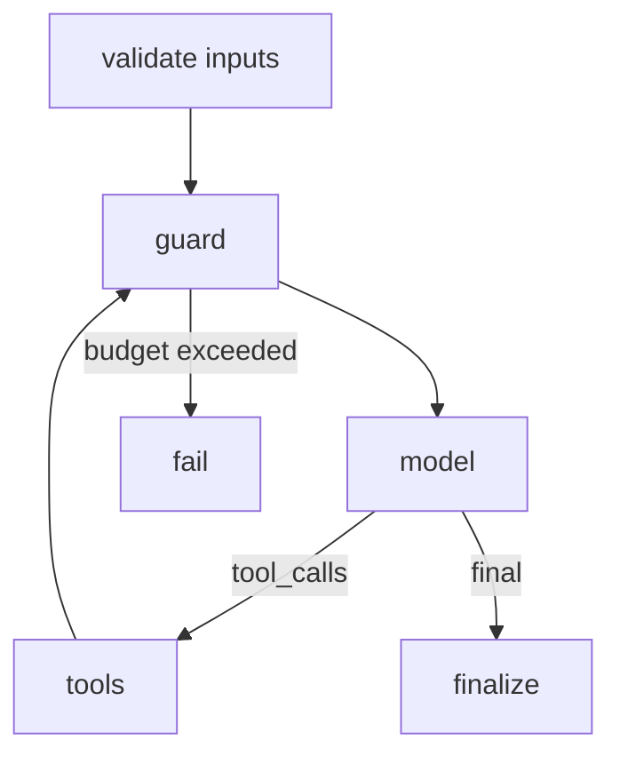

# Agent Design — <name> — v0.1 — <date>

**Decision:** <pattern chosen> because <criterion that ruled out the simpler option>.

## 1. Job and success metric
| Item | Value |
|---|---|
| Job to be done | |
| Success metric (baseline → target) | [TO BE BASELINED — owner: ___] |
| Users / callers | |
| Volume (runs/day) | |
| Latency SLO / cost envelope per run | |

## 2. Pattern decision
| Option | Meets criteria? | Reason |
|---|---|---|
| Workflow | | |
| Single agent | | |
| Multi-agent (<variant>) | | |

## 3. State schema
| Field | Type | Owner node | Reducer | Reset rule |
|---|---|---|---|---|

## 4. Graph

| Node | Responsibility | Model/tool | Timeout | Retry |
|---|---|---|---|---|

## 5. Tool contracts
| Tool | Side-effect class | Idempotent | Scopes | Timeout | Error codes |
|---|---|---|---|---|---|
Contracts: `tools/<name>.json` (schema: `assets/tool-contract.schema.json`).

## 6. HITL checkpoints
| Checkpoint | Trigger | Human sees | Decisions | Expiry / default |
|---|---|---|---|---|

## 7. Failure modes
| Failure | Detection | Mitigation | Owner |
|---|---|---|---|

## 8. Budgets
| Budget | Value |
|---|---|
| Max steps | |
| Max tokens / cost per run | |
| Max wall-clock | |
| Fan-out cap | |

## 9. Observability and evaluation
- Trace fields: trace_id, thread_id, tenant_id, node, step_count, model, prompt_version, tokens, cost, latency, tool_name, status
- Golden set location and gate threshold: see `llm-eval-harness`
- Production sampling rate for review: 

## 10. Security and data
| Concern | Control |
|---|---|
| AuthZ | in code and tool server; tenant from auth context |
| Untrusted content | delimited, labeled; no privileged tools in the same phase |
| PII | |
| Retention of checkpoints | |

## 11. Open questions
| # | Question | Owner | Date |
|---|---|---|---|
