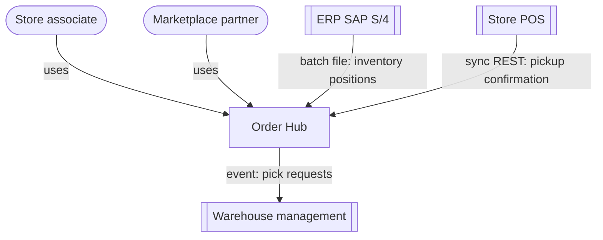
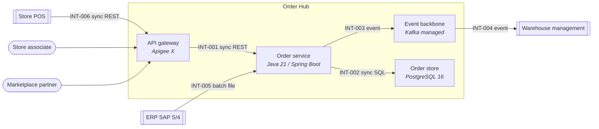
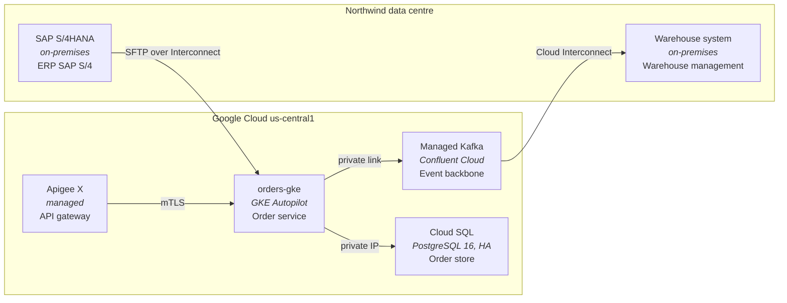

# Solution Architecture — Northwind — Order Hub

*Sample: Fictional company, people and figures, for demonstration. Every value below is stated by this file; nothing in the outputs goes beyond it.*

Generated from `northwind-order-hub.json`: 4 containers, 2 actors, 3 external systems, 6 integrations, 5 NFRs, 3 decisions. For: CIO steering committee · As of: 2026-10-20.

## Bottom line
**Order Hub** — Order orchestration for buy-online-pickup-in-store and marketplace orders. Recommended: event backbone for order events on **Kafka (managed)** (ADR-001); order store database on **PostgreSQL 16** (ADR-002); API entry point for stores and partners on **Apigee X** (ADR-003). Delivered in 2 waves: wave 1 — Orders are created and stored through the API gateway; wave 2 — Picking and inventory are integrated. 2 high-rated risks, led by: Nightly SAP inventory file makes intraday promises inaccurate. 6 items still need a baseline or an owner (see Open items).

## Drivers and constraints

| Type | Statement | Source |
|---|---|---|
| goal | Offer same-day buy-online-pickup-in-store in every store | RFP §2.1 |
| goal | Take marketplace partner orders through one governed API | RFP §2.3 |
| constraint | SAP S/4 stays the system of record for inventory | CIO steering minutes 2026-08-14 |
| constraint | Apigee X is the enterprise API standard | EA standards v3 §4 |
| constraint | Order volume peaks at three times normal from November to December | Northwind operations data 2025 |

## System context (C4 level 1)

*Figure 1 — System context for Order Hub: who uses it and what it exchanges data with; sources: northwind-order-hub.json*

## Container view (C4 level 2)

*Figure 2 — Containers and integrations, with each integration's ID, pattern and protocol; sources: northwind-order-hub.json*

| Container | Technology | Responsibility |
|---|---|---|
| API gateway (`gw`) | Apigee X | AuthN/Z, routing, rate limits |
| Order service (`orders`) | Java 21 / Spring Boot | Order orchestration and promise |
| Event backbone (`events`) | Kafka (managed) | Async integration, replay, DLQ |
| Order store (`db`) | PostgreSQL 16 | Orders and fulfilment state |

## Deployment view

*Figure 3 — Where each container runs. Google Cloud for Order Hub; SAP and warehouse systems stay in the Northwind data centre; sources: northwind-order-hub.json*

## Integration map (grouped by pattern)

### sync REST
| ID | From | To | Protocol | Data | Wave |
|---|---|---|---|---|---|
| INT-001 | API gateway | Order service | HTTPS/JSON | order create/read | 1 |
| INT-006 | Store POS | API gateway | HTTPS/JSON | pickup confirmation | [TO BE BASELINED — owner: Solution architect] |

### sync SQL
| ID | From | To | Protocol | Data | Wave |
|---|---|---|---|---|---|
| INT-002 | Order service | Order store | TLS | order state | 1 |

### event
| ID | From | To | Protocol | Data | Wave |
|---|---|---|---|---|---|
| INT-003 | Order service | Event backbone | Kafka | OrderPlaced, OrderPicked | 1 |
| INT-004 | Event backbone | Warehouse management | connector | pick requests | 2 |

### batch file
| ID | From | To | Protocol | Data | Wave |
|---|---|---|---|---|---|
| INT-005 | ERP (SAP S/4) | Order service | SFTP nightly | inventory positions | 2 |

## Migration waves

| Wave | Goal | Integrations | Entry criteria | Exit criteria | Rollback |
|---|---|---|---|---|---|
| 1 | Orders are created and stored through the API gateway | INT-001, INT-002, INT-003 | Gateway and Order service in staging; availability probe live | Associates in 20 pilot stores create and read orders for two weeks without a severity-1 incident | Route pilot stores back to the legacy order screen |
| 2 | Picking and inventory are integrated | INT-004, INT-005 | Wave 1 exit met; warehouse connector load-tested | Pick requests reach the warehouse system for every store; nightly inventory reconciles | Pause the warehouse connector; picks continue through the legacy batch |
| [TO BE BASELINED — owner: Solution architect] | [TO BE BASELINED — owner: Solution architect] | INT-006 | | | |

## Non-functional requirements
| Category | Requirement | Target | Measure | Source |
|---|---|---|---|---|
| Availability | Order API available during peak | 99.9% monthly | synthetic probe, 1-min interval | RFP §4.2 |
| Scalability | Peak order intake | 450 orders/min sustained for 2 h | load test at wave 2 exit | Northwind operations data 2025 |
| Performance | Order create p95 latency | [TO BE BASELINED — owner: Solution architect] | gateway analytics | [TO BE BASELINED — owner: Solution architect] |
| Recoverability | Order store RPO/RTO | RPO 5 min / RTO 1 h | DR drill twice a year | CTO statement 2026-09-02 |
| Security | PCI scope excluded from Order Hub | [TO BE BASELINED — owner: Solution architect] | [TO BE BASELINED — owner: Solution architect] | [TO BE BASELINED — owner: Solution architect] |

## Security and data

| Area | Control | Source |
|---|---|---|
| Identity | Store associates sign in with Northwind SSO (OIDC) at the gateway; partners use API keys with quotas | EA standards v3 §6 |
| Data in transit | TLS 1.2 or later on every integration; mutual TLS between gateway and Order service | EA standards v3 §7 |
| Payment data | [TO BE BASELINED — owner: Solution architect] | [TO BE BASELINED — owner: Solution architect] |

## Options and decisions

Each option is scored 1 (poor) to 5 (strong) per criterion; the weighted score is Σ(weight × score) ÷ Σweights. Scores and weights are the workshop's, as recorded in the source.

### ADR-001 — Event backbone for order events

**Context.** Pick queues must be rebuilt from order events after a warehouse system outage; events must be replayable for 7 days (CTO statement 2026-09-02).

| Option | Replay and ordering (35) | Operational effort (25) | Ecosystem fit (20) | Cost (20) | Weighted score |
|---|---|---|---|---|---|
| Kafka (managed) **(chosen)** | 5 | 3 | 4 | 3 | 3.9 |
| Cloud Pub/Sub | 2 | 5 | 4 | 4 | 3.55 |
| IBM MQ | 3 | 3 | 2 | 3 | 2.8 |

**Decision.** Kafka (managed) — Only option that meets the 7-day replay requirement natively, with per-key ordering for order lifecycles.

**Consequences.**
- The platform team operates a managed Kafka cluster with a schema registry
- Every consumer must be idempotent

Owner: Head of Integration, Northwind · Status: proposed · Source: Architecture workshop 2026-10-07

### ADR-002 — Order store database

**Context.** Order state changes must be transactional across order lines and fulfilment steps.

| Option | Transactional integrity (40) | Team skills (30) | Cost (30) | Weighted score |
|---|---|---|---|---|
| PostgreSQL 16 **(chosen)** | 5 | 5 | 4 | 4.7 |
| Cloud Spanner | 5 | 2 | 2 | 3.2 |
| MongoDB Atlas | 3 | 3 | 3 | 3.0 |

**Decision.** PostgreSQL 16 — Meets transactional needs at the stated peak with the skills the team already has.

**Consequences.**
- Read replicas serve status queries at peak
- Partitioning by order month is planned before wave 2

Owner: Lead engineer, Order service · Status: accepted · Source: Architecture workshop 2026-10-07

### ADR-003 — API entry point for stores and partners

**Context.** Marketplace partners and store systems need one governed, rate-limited entry point.

| Option | Security and policy (50) | Standards compliance (30) | Latency (20) | Weighted score |
|---|---|---|---|---|
| Apigee X **(chosen)** | 5 | 5 | 3 | 4.6 |
| Direct service exposure | 2 | 1 | 5 | 2.3 |

**Decision.** Apigee X — The enterprise API standard; partner keys, quotas and threat protection come with it.

**Consequences.**
- One extra network hop on every call; measured against the p95 target once it is set

Owner: Enterprise architect, Northwind · Status: accepted · Source: EA standards v3 §4

## Risks

Rating = likelihood × impact (each 1–5; low/medium/high read as 1/3/5): 15 and above high, 8–14 medium, below 8 low.

| Risk | Likelihood | Impact | Rating | Mitigation | Owner |
|---|---|---|---|---|---|
| Nightly SAP inventory file makes intraday promises inaccurate | 4 | 4 | 16 (high) | Decide on near-real-time inventory events before wave 3 (new ADR) | Solution architect |
| Warehouse connector throughput falls short of peak pick volume | 3 | 5 | 15 (high) | Load test the connector at three times normal volume before the wave 2 exit | Integration lead |
| Payment data enters Order Hub and widens PCI scope | 2 | 5 | 10 (medium) | Payment tokens stay with the payment provider; a contract test rejects card fields | Security architect |
| Store POS upgrade dates are not known | 3 | 3 | 9 (medium) | [TO BE BASELINED — owner: Solution architect] | [TO BE BASELINED — owner: Solution architect] |

## Decision log
| ADR | Decision | Chosen | Status | Owner |
|---|---|---|---|---|
| ADR-001 | Event backbone for order events | Kafka (managed) | proposed | Head of Integration, Northwind |
| ADR-002 | Order store database | PostgreSQL 16 | accepted | Lead engineer, Order service |
| ADR-003 | API entry point for stores and partners | Apigee X | accepted | Enterprise architect, Northwind |

Technology choices without a decision record yet (each needs an ADR):
- Order service on Java 21 / Spring Boot

## Open items
| Item | Owner | Section |
|---|---|---|
| NFR target: Performance — Order create p95 latency | [TO BE BASELINED — owner: Solution architect] | Non-functional requirements |
| NFR target: Security — PCI scope excluded from Order Hub | [TO BE BASELINED — owner: Solution architect] | Non-functional requirements |
| Wave for INT-006 | [TO BE BASELINED — owner: Solution architect] | Integration map |
| Owner for risk: Store POS upgrade dates are not known | [TO BE BASELINED — owner: Solution architect] | Risks |
| Mitigation for risk: Store POS upgrade dates are not known | [TO BE BASELINED — owner: Solution architect] | Risks |
| Control for: Payment data | [TO BE BASELINED — owner: Solution architect] | Security and data |

## Sources
Every statement above is traceable to one of these (as given in the input):
- RFP §2.1
- RFP §2.3
- CIO steering minutes 2026-08-14
- EA standards v3 §4
- Northwind operations data 2025
- RFP §4.2
- CTO statement 2026-09-02
- Architecture workshop 2026-10-07
- EA standards v3 §6
- EA standards v3 §7
